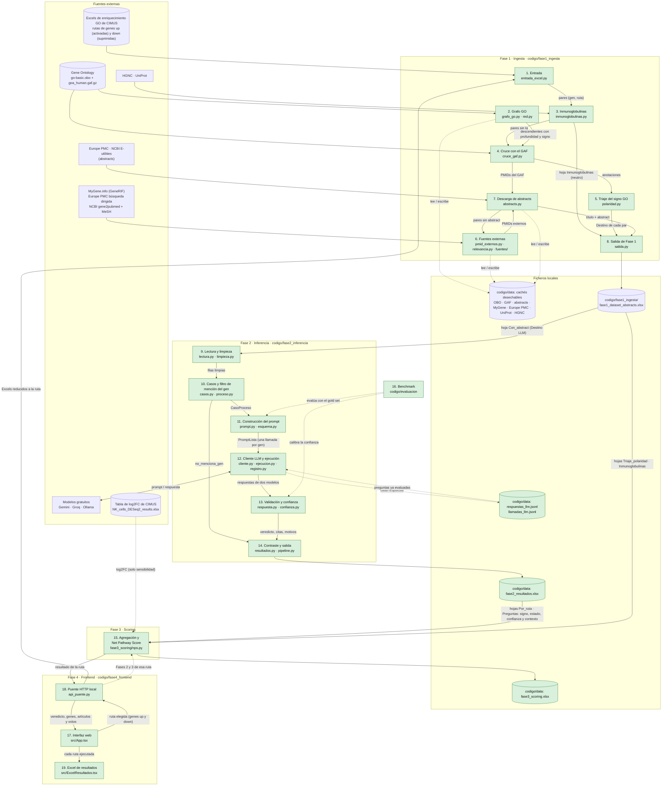

# Arquitectura de la solución

Este documento describe las piezas del pipeline, de qué se responsabiliza cada una y cómo circula la información desde los resultados de enriquecimiento de CIMUS hasta el signo funcional de cada gen. Las decisiones que justifican esta arquitectura están en [`decisions/`](decisions/) y el detalle funcional de cada pieza en [`specs/`](specs/).

El código vive en `codigo/`, dentro de esta misma carpeta del equipo (`entregas/cu-01-reinterpretacion-biologica/codigo/`), y se organiza en cuatro fases:

* **Fase 1, ingesta** (`codigo/fase1_ingesta/`, `python codigo/fase1_ingesta/main.py`): de las rutas enriquecidas a un Excel con las evidencias bibliográficas de cada par gen–ruta y un primer triaje del signo con Gene Ontology. **Implementada.**
* **Fase 2, inferencia** (`codigo/fase2_inferencia/`; desde `codigo/`, `python -m fase2_inferencia ejecutar`): de cada evidencia a un signo funcional validado. **Implementada**, con Gemini 3.5 Flash-Lite como principal y gpt-oss-120b como secundario (ADR-005).
* **Fase 3, scoring** (`codigo/fase3_scoring/`; desde `codigo/`, `python -m fase3_scoring`; [spec](specs/scoring-net-pathway-score.md)): de los signos por evidencia al *Net Pathway Score* de cada ruta. **Implementada**; sus umbrales son provisionales.
* **Fase 4, frontend** (`codigo/fase4_frontend/`; [instrucciones](codigo/fase4_frontend/instrucciones_uso_frontend.md)): interfaz web para ejecutar **una ruta** de principio a fin. Se suben los Excels de rutas sobreexpresadas e infraexpresadas (uno por lista; no hay nada precargado), se elige una ruta y, tras confirmarlo, el puente HTTP local (`api_puente.py`) ejecuta seguidas las Fases 1, 2 y 3. Muestra el veredicto de la ruta con la escala del NPS, una tarjeta por fase y la tabla gen a gen en lenguaje llano (artículos con su cita, tipo de evidencia, peso de cada voto y hacia dónde se inclinaba el LLM cuando no hay conclusión). Una persona experta puede cambiar a mano el signo de un gen (columna «Tu criterio»): la lectura se recalcula en pantalla con las reglas de la Fase 3 y el cambio no se guarda. El «Excel de resultados» acumula las rutas ejecutadas (hojas `Rutas` y `Genes`). Cada ruta escribe en `codigo/data/frontend/<GO_ID>/` y reutiliza las cachés y el registro del LLM. **Implementada.**

## Diagrama

**Leyenda:** verde = implementado · amarillo = implementado en parte · rojo discontinuo = pendiente. Las flechas discontinuas indican lectura o escritura de ficheros y evaluación.

## Componentes

### Fase 1 · Ingesta ([spec](specs/descarga-evidencias-go-pmc.md) · [ADR-002](decisions/adr-002-europe-pmc-api.md))

El orden de ejecución es el de `main.py`.

| # | Componente | Responsabilidad | Recibe | Produce | Estado |
|---|---|---|---|---|---|
| 1 | **Entrada** (`entrada_excel.py`) | Leer los dos Excels de enriquecimiento GO, separar los genes de cada ruta y traducir identificadores GO obsoletos. | Ficheros con columnas `ID`, `Description`, `geneID`, en `codigo/tools_cimus/` (`config.EXCEL_ACTIVADAS` y `EXCEL_SUPRIMIDAS`). | Tabla (`Gen`, `GO_ID`, `Ruta_Nombre`, `Estado_Original`) y conjunto de pares (gen, ruta). `Estado_Original` («Activada» / «Suprimida») indica la lista de origen, y de ella sale la dirección del gen (*up* / *down*). | Hecho. Acepta `.xlsx` y `.csv`, y `main.py` valida las columnas (`ValueError`) antes de cualquier descarga. |
| 2 | **Grafo GO** (`grafo_go.py`, `red.py`) | Descargar el OBO y el GAF, construir el grafo de términos y propagar cada ruta a todo su subárbol (`is_a`, `part_of`, `regulates`…), con la profundidad y el signo del camino. | `go-basic.obo`. | Para cada ruta, sus descendientes con profundidad y estado de signo. Reglas: signo por pertenencia en «positive/negative regulation of X»; «regulation of X» sin dirección tratada como X (`SIN_DIRECCION_COMO_PROCESO`); sin propagar la regulación tras `part_of` ni por aristas sin signo. | Hecho. |
| 3 | **Inmunoglobulinas** (`inmunoglobulinas.py`, `fuentes/uniprot.py`) | Apartar los genes de inmunoglobulina antes del cruce: se evalúa la Ig completa, que no activa ni inhibe la ruta. | Genes de la entrada; lista HGNC `immunoglobulin gene` más JCHAIN y PIGR. | Hoja `Inmunoglobulinas`, con signo `neutro` y la función de la Ig completa según UniProt. Estos pares no llegan al LLM. | Hecho. |
| 4 | **Cruce con el GAF** (`cruce_gaf.py`) | Leer el GAF humano en una pasada y quedarse con las anotaciones de cada gen a la ruta o a sus descendientes. | GAF, pares (gen, ruta) y descendientes. | Evidencias con PMID (`Gen`, `GO_ID`, `PMID`, `GO_ID_anotado`, `Profundidad`, `Evidencia`, `Polaridad_GO`, `Experimental`…), anotaciones sin PMID, genes no encontrados y una tabla por anotación con el calificador y la extensión, para el triaje. | Hecho. |
| 5 | **Triaje del signo GO** (`polaridad.py`) | Decidir, para cada par, si el signo de GO basta o hace falta el LLM. | Anotaciones del componente 4. | Columna `Destino`: `aceptar_GO` (signo de GO aceptado, sin LLM), `LLM`, `LLM_y_revision` o `sin_evidencia` (el par no tiene ningún abstract y se cierra como `UNKNOWN`), con su motivo, la profundidad y la bandera de freno o retroalimentación. Hoja `Triaje_polaridad`. | Hecho. |
| 6 | **Fuentes externas** (`pmid_externos.py`, `relevancia.py`, `fuentes/generif.py`, `fuentes/europepmc.py`, `fuentes/gene2pubmed.py`) | Buscar PMIDs para los pares sin abstract utilizable en el GAF. | Pares sin abstract, subárbol de cada ruta y sinónimos del OBO. | PMIDs de NCBI GeneRIF (vía MyGene.info, solo si el texto nombra al gen) y, para los que siguen vacíos, de una búsqueda dirigida en Europe PMC (el gen y un término del subárbol en la misma frase) y, si siguen vacíos, de gene2pubmed + MeSH de la ruta + «Humans» (los artículos que NCBI liga al gen con el MeSH de la ruta, de `fase1_ingesta/tabla_go_mesh.tsv`; los 3 más recientes que nombran el gen). Como máximo 10 PMIDs por par. | Hecho. |
| 7 | **Descarga de abstracts** (`abstracts.py`) | Obtener título y abstract de cada PMID: Europe PMC por lotes y NCBI como respaldo, con reintentos y caché. | Lista de PMIDs únicos. | Tabla (`PMID`, `Titulo`, `Abstract`). `cache_abstracts.json` guarda el texto en crudo, y `limpiar_texto` se aplica al leerlo. | Hecho. |
| 8 | **Salida de Fase 1** (`salida.py`) | Unir entrada, evidencias, triaje y abstracts, mostrar el embudo por consola y escribir el Excel. | Salidas de 1 a 7. | `codigo/fase1_ingesta/fase1_dataset_abstracts.xlsx` con 7 hojas: `Con_abstract`, `PMID_sin_abstract`, `Anotado_sin_PMID`, `Genes_no_encontrados`, `Triaje_polaridad`, `Inmunoglobulinas` y `Sin_evidencia`. Las tres primeras llevan el `Destino` del triaje. | Hecho. |

### Fase 2 · Inferencia ([spec de limpieza](specs/limpieza-abstracts-particion-genica.md) · [spec de inferencia](specs/inferencia-llm.md) · [ADR-003](decisions/adr-003-control-alucinaciones-unknown.md) · [ADR-004](decisions/adr-004-persistencia-ficheros-locales.md) · [ADR-005](decisions/adr-005-eleccion-modelo-coste-cero.md))

| # | Componente | Responsabilidad | Recibe | Produce | Estado |
|---|---|---|---|---|---|
| 9 | **Lectura y limpieza** (`lectura.py`, `limpieza.py`) | Leer la hoja `Con_abstract` de las dos listas, quedarse con los pares que van al LLM (no `aceptar_GO` ni `sin_evidencia`), limpiar el abstract sin recortarlo, partirlo en frases y ofrecer la forma de comparación que usa 13 para verificar las citas. | Hoja `Con_abstract`. | Filas limpias. | Hecho. |
| 10 | **Casos y filtro de mención del gen** (`casos.py`, `proceso.py`) | Agrupar las filas en preguntas (gen, PMID, proceso núcleo), guardar el factor que traduce el efecto en el signo de cada ruta y cerrar sin LLM las preguntas cuyo texto no nombra al gen por su símbolo, sus alias o su nombre completo. | Filas limpias y datos de MyGene. | `CasoProceso`, o pregunta cerrada con `no_menciona_gen`. | Hecho. |
| 11 | **Construcción del prompt** (`prompt.py`, `esquema.py`) | Generar el mismo prompt para todos los modelos: abstract completo en frases numeradas, sin dirección de scRNA-seq, sin polaridad de GO y sin contexto HNSC, con 14 reglas y la lista de campos del JSON. El modelo siempre da un veredicto (+1, −1 o neutro), su confianza y de 1 a 3 frases con su cita; el prompt no menciona ningún umbral. Las preguntas de un gen van juntas, troceadas según el presupuesto por llamada. | `CasoProceso`. | `PromptLLM` por pregunta y `PromptLista` por llamada. | Hecho. |
| 12 | **Cliente LLM y ejecución** (`cliente.py`, `ejecucion.py`, `registro.py`) | Enviar cada lista al principal y, solo si falla, al secundario, con un único conector compatible con la API de chat de OpenAI, reintentar ante `408`, `429` y `5xx`, y no repetir preguntas ya registradas. | `PromptLista` y registro. | Una línea por pregunta en `respuestas_llm.jsonl` y una por llamada en `llamadas_llm.jsonl`. Un modelo que agota su límite diario deja sus preguntas pendientes. El secundario solo recibe las preguntas que el principal no ha podido responder o respondió con un JSON que no vale (`--contraste`, solo para experimentos, se las envía todas). | Hecho y probado con llamadas reales a Gemini, Groq y Ollama. |
| 13 | **Validación y confianza** (`respuesta.py`, `confianza.py`) | Extraer el JSON, comprobar el esquema, verificar las citas (≥6 palabras, en la frase indicada), decidir el `UNKNOWN` (sin cita verificada o con confianza por debajo de `UMBRAL_VEREDICTO = 80`), componer el signo de cada ruta y calcular `confianza_final`. | Texto de respuesta y `CasoProceso`. | Por modelo: veredicto, signo, estado, motivos, citas, `confianza_modelo` y signo por ruta. | Hecho. |
| 14 | **Contraste y salida** (`resultados.py`, `pipeline.ejecutar_fase2`) | Elegir la respuesta (la del principal; si no responde o su JSON no vale, la del secundario con `respaldo_secundario`; con `--contraste`, además `discrepancia_entre_modelos`) y comparar el veredicto de cada ruta con `Polaridad_GO`: si coincide y hay alguna cita verificada, se acepta aunque la confianza no llegue al umbral (`coincide_polaridad_GO`); si no, `discrepancia_polaridad_GO`. Escribir la salida. | Resultados validados de ambos modelos y `Polaridad_GO`. | `codigo/data/fase2_resultados.xlsx`: hojas `Por_ruta` y `Preguntas` (entradas del scoring: signo y contexto) y `Resumen`, con el signo del modelo que decide (el principal, o el secundario con `respaldo_secundario`), `Estado` (`resuelto` / `revisar` / `no_concluyente` / `pendiente`), `Motivos` y `Confianza_final`. | Hecho. |

### Fase 3 y evaluación

| # | Componente | Responsabilidad | Estado |
|---|---|---|---|
| 15 | **Agregación y Net Pathway Score** (`fase3_scoring/nps.py`, `fase3_scoring/config.py`) | Agregar los signos de todos los PMIDs de cada par gen–ruta y combinarlos con la dirección del gen para obtener la contribución neta a la ruta, con el log2 Fold-Change como análisis de sensibilidad. Sin red ni LLM, determinista. | Hecho según [`scoring-net-pathway-score.md`](specs/scoring-net-pathway-score.md): voto ponderado por `Confianza_final` y contexto, conflicto a `revisar` si la minoría pesa ⅓ o más, y `NPS` = media de signo × dirección, con todos los genes con el mismo peso. Con la tabla de log2FC de CIMUS (`tools_cimus/NK_cells_DESeq2_results.xlsx`) calcula además `NPS_log2FC` y marca `Sensible_al_peso` en las 20 rutas cuya lectura cambia. Escribe `codigo/data/fase3_scoring.xlsx` (hojas `Por_ruta`, `Por_par`, `Resumen` y `Abstracts_sin_signo`, con los artículos de los pares sin signo enlazados a PubMed para leerlos a mano). |
| 16 | **Benchmark** (`codigo/evaluacion/`, [spec](specs/benchmark-gold-set.md)) | Evaluar los candidatos sobre un *gold set* etiquetado a ciegas, medir la calibración de la confianza y elegir los modelos de producción. | Hecho: *gold set* de 100 casos (65 de genes *up* y 35 de genes *down*) etiquetado a ciegas por anotadores Claude con doble etiqueta. Gemini y gpt-oss están completos (100 de 100). |

### Fase 4 · Frontend ([instrucciones](codigo/fase4_frontend/instrucciones_uso_frontend.md))

| # | Componente | Responsabilidad | Estado |
|---|---|---|---|
| 17 | **Interfaz web** (`codigo/fase4_frontend/src/App.tsx`, React + Vite) | Subir un Excel de rutas sobreexpresadas y otro de infraexpresadas (uno por lista, con «Cambiar» y «Quitar»), elegir una ruta y confirmarla. Mostrar el veredicto (lectura, escala del NPS, genes que la sostienen y cuántos tendrían que cambiar para perderla), una tarjeta por fase y la tabla gen a gen en lenguaje llano. La columna «Tu criterio» deja a una persona experta fijar el signo de un gen y recalcula la lectura en pantalla con las reglas de `fase3_scoring/nps.py`, sin guardar nada. Tema oscuro o claro. | Hecho. |
| 18 | **Puente HTTP local** (`codigo/fase4_frontend/api_puente.py`) | `POST /ejecutar-ruta` lanza en un hilo las Fases 1 → 2 → 3 con los Excels reducidos a la ruta (sin tocar el código de las fases: redirige sus rutas de entrada y salida) y `GET /estado` informa de la fase en curso y del resultado. Devuelve, además de las hojas de la Fase 3, los artículos de cada gen con su cita, el tipo de evidencia, el peso de cada voto y lo que contestó el LLM. Una ruta a la vez; escribe en `codigo/data/frontend/<GO_ID>/`. | Hecho. |
| 19 | **Excel de resultados** (`codigo/fase4_frontend/src/ExcelResultados.tsx`) | Acumular en un Excel elegido por la persona (vacío o con rutas ya buscadas) una fila por ruta ejecutada en la hoja `Rutas` y sus genes en `Genes`; si la ruta ya estaba, se actualiza. En Chrome y Edge escribe directamente en el fichero; en otros navegadores, con «Descargar». Limpiar, quitar una ruta y vista previa. | Hecho. |

## Flujo de principio a fin

Las cifras son de la ejecución de referencia del 2026-11-13: las de los pasos 1 a 9, de la Fase 1; las de los pasos 10 a 13, de la Fase 2 sobre ella, y las del paso 14, de la Fase 3.

1. **Entrada.** El componente 1 lee los dos Excels de CIMUS. La lista de rutas de genes *up* (activadas) tiene **314 rutas**, **2.489 pares** gen–ruta y **126 genes**; la de genes *down* (suprimidas), **78 rutas**, **683 pares** y **98 genes**. En total son **3.172 pares** de **224 genes**, y ningún gen está en las dos listas.
2. **Grafo.** El componente 2 descarga el OBO y el GAF (solo la primera vez) y, para cada ruta, calcula todos sus descendientes con su profundidad y el signo del camino.
3. **Inmunoglobulinas.** El componente 3 aparta **103 pares** de inmunoglobulinas como neutros. Quedan **3.069 pares**.
4. **Evidencias.** El componente 4 recorre el GAF una sola vez: **1.547 pares** tienen al menos un PMID en el GAF.
5. **Triaje.** El componente 5 decide el destino de cada par: **332** `aceptar_GO`, **2.361** `LLM`, **66** `LLM_y_revision` y, al final, **310** `sin_evidencia`.
6. **Fuentes externas.** Para los **1.523 pares** sin abstract utilizable del GAF, el componente 6 busca en GeneRIF, en Europe PMC y en gene2pubmed + MeSH: **1.213 pares** consiguen algún PMID.
7. **Abstracts.** El componente 7 consulta primero la caché local; los PMIDs que faltan los pide a Europe PMC por lotes y, los que esta no devuelve, a NCBI. En total son **1.842 PMIDs** y **2.759 pares** con al menos un abstract. Los **310 pares** que siguen sin ninguno se cierran como `UNKNOWN` (`sin_evidencia`).
8. **Excel de Fase 1.** El componente 8 escribe `fase1_dataset_abstracts.xlsx`, que es el contrato entre las dos fases: **5.963 filas** (gen, ruta, PMID) en `Con_abstract`, el 22 % con `Polaridad_GO` +1 o −1.
9. **Evidencias limpias.** El componente 9 lee la hoja `Con_abstract` de las dos listas y se queda con los pares que el triaje manda al LLM.
10. **Casos y filtro.** El componente 10 agrupa las filas en preguntas (gen, PMID, proceso núcleo) y cierra sin coste las 92 que no mencionan el gen. Quedan **2.464 preguntas** para el LLM, de **188 genes**: 1.692 de las rutas de genes *up* y 772 de las de genes *down*.
11. **Prompt y modelos.** El componente 11 construye el prompt (las preguntas de un gen van juntas) y el 12 lo envía a los dos modelos. Antes de cada llamada consulta el registro: si la pregunta ya se evaluó con ese mismo prompt, no la repite. Cada respuesta se escribe en el registro en cuanto llega, de modo que una ejecución interrumpida (por ejemplo, al agotar el límite diario gratuito) se reanuda donde se quedó.
12. **Validación.** El componente 13 valida cada respuesta por separado. Fuerza `UNKNOWN` si ninguna cita aparece en su frase, si el JSON no es interpretable o si la confianza no llega al umbral. Manda a `revisar` un veredicto que llega al umbral pero trae una limitación, y traduce el efecto sobre el proceso al signo de cada ruta.
13. **Contraste.** El componente 14 fija el signo final (el del modelo principal), acepta los veredictos que coinciden con GO, marca el caso como `revisar` si los modelos discrepan entre sí o con GO, calcula `confianza_final` y escribe `fase2_resultados.xlsx`. Lo que el principal no ha respondido por el límite diario queda `pendiente` y la siguiente ejecución lo completa.
   En la ejecución del Excel completo de CIMUS (352 rutas), Gemini respondió 2.456 preguntas y gpt-oss 8 como respaldo, sin ninguna pendiente. De las **5.656 filas** de `Por_ruta`, 2.182 salen `resuelto` (1.582 `+1`, 559 `−1` y 41 neutras), 133 `revisar` y 3.341 `no_concluyente`, casi todas por `baja_confianza`.
14. **Scoring.** El componente 15 agrega los casos de cada par gen–ruta y calcula el *Net Pathway Score*. De los **3.172 pares**, 1.693 quedan resueltos (1.214 `+1`, 356 `−1` y 123 neutros, 103 de ellos inmunoglobulinas), 192 en `revisar` (77 por `conflicto_entre_abstracts`) y 1.287 sin signo. De las **352 rutas**, 132 se leen `activada`, 29 `inhibida`, 45 `mixta` y 146 `insuficiente` (menos de 3 pares con signo o cobertura < 30 %). 17 rutas de la lista de genes *up* salen inhibidas y 2 de la de genes *down*, activadas.

**Ejemplo, CD7 en *leukocyte mediated immunity* (GO:0002443):**
1. **Componente 4:** encuentra que CD7 está anotado con evidencia `IDA` (PMID 10652336) al término descendiente GO:0002726, *positive regulation of T cell cytokine production*, por lo que `Polaridad_GO = +1`.
2. **Componente 5:** manda el par al LLM con el motivo `lejano`, porque la anotación está a profundidad 4.
3. **Componente 10:** pregunta por el proceso núcleo, *T cell cytokine production* (GO:0002369). El abstract describe a CD7 como receptor de la proteína K12, y el efecto sobre las células lo produce K12-Fc, no CD7.
4. **Componente 13:** en el benchmark, Gemini respondió `NO_EFFECT` con confianza 0 y la limitación `process_not_addressed`, citando una frase verificada. Al quedar por debajo del umbral, el código lo convierte en `UNKNOWN`.
5. **Componente 14:** como el veredicto (neutro) no coincide con la `Polaridad_GO` (+1), la fila de `Por_ruta` sale con `Signo_ruta = UNKNOWN`, `Estado = revisar` y los motivos `baja_confianza`, `contexto_ajeno` y `discrepancia_polaridad_GO`. El caso pasa al experto con la cita y las dos fuentes, en vez de aceptar el `+1` que habría dado un modelo complaciente.

## Pendiente de decidir
* **Fase 3:** los valores provisionales de la spec de scoring (pesos de contexto, minoría de ⅓ y umbrales de lectura del NPS) y la revisión a mano de las 20 rutas `Sensible_al_peso`.

## Decisiones de arquitectura
| ADR | Decisión |
|---|---|
| [ADR-001](decisions/adr-001-rag-stateless.md) | Pipeline RAG con un LLM externo en lugar de un clasificador biomédico entrenado. |
| [ADR-002](decisions/adr-002-europe-pmc-api.md) | Evidencias desde el GAF de Gene Ontology y abstracts de Europe PMC con respaldo en NCBI. |
| [ADR-003](decisions/adr-003-control-alucinaciones-unknown.md) | Control de alucinaciones: signo, estado y motivos, con verificación de citas, umbral de confianza y contraste con GO y entre modelos. |
| [ADR-004](decisions/adr-004-persistencia-ficheros-locales.md) | Persistencia en ficheros locales: cachés desechables y registro JSONL de respuestas, sin bases de datos. |
| [ADR-005](decisions/adr-005-eleccion-modelo-coste-cero.md) | Elección de modelos con coste cero mediante benchmark: principal Gemini 3.5 Flash-Lite y secundario gpt-oss-120b. |
