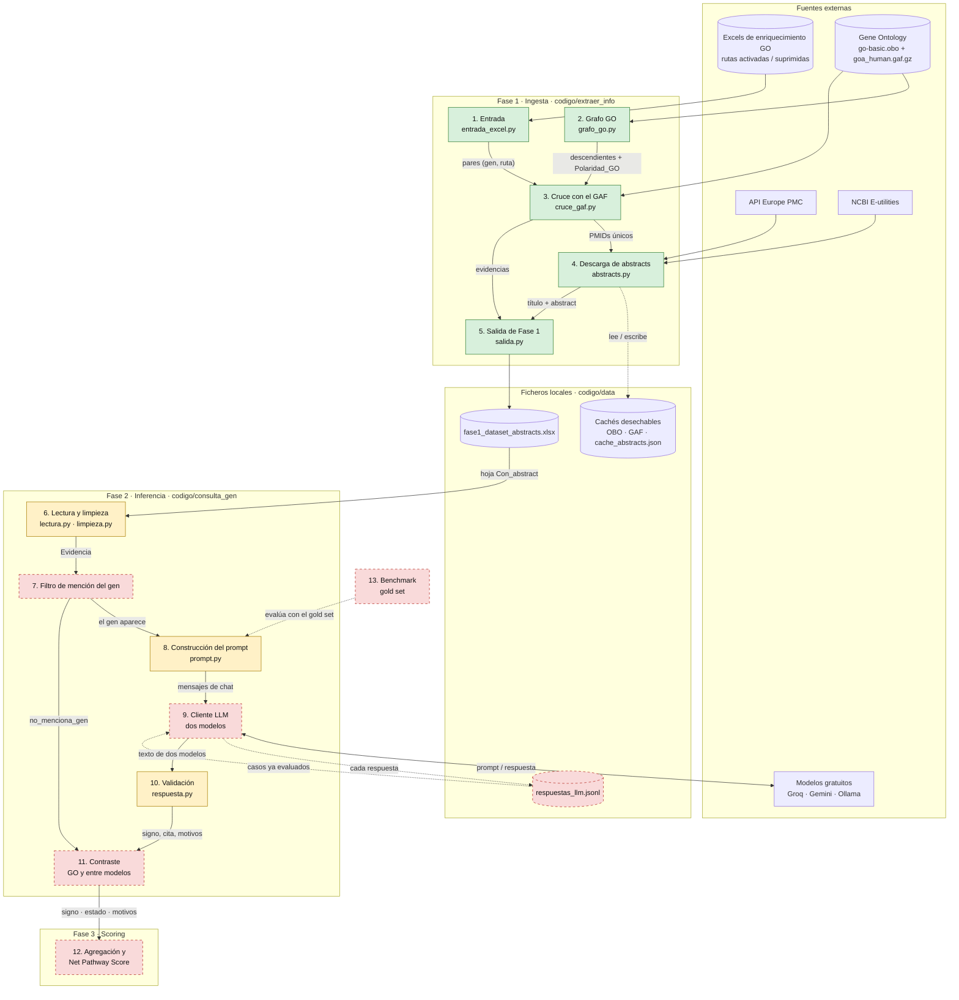

# Arquitectura de la solución

Este documento describe las piezas del pipeline, de qué se responsabiliza cada una y cómo circula la información desde los resultados de enriquecimiento de CIMUS hasta el signo funcional de cada gen. Las decisiones que justifican esta arquitectura están en [`decisions/`](decisions/) y el detalle funcional de cada pieza en [`specs/`](specs/).

El código vive en `codigo/` (en la raíz del repositorio) y se organiza en tres fases:

* **Fase 1, ingesta** (`codigo/extraer_info/`): de las rutas enriquecidas a un Excel con las evidencias bibliográficas de cada par gen–ruta. **Implementada.**
* **Fase 2, inferencia** (`codigo/consulta_gen/`): de cada evidencia a un signo funcional validado. **Parcialmente implementada.**
* **Fase 3, scoring**: de los signos por evidencia al *Net Pathway Score* de cada ruta. **Pendiente de especificar.**

## Diagrama

**Leyenda:** verde = implementado · amarillo = implementado en parte, con cambios acordados pendientes · rojo discontinuo = pendiente. Las flechas discontinuas indican lectura o escritura de ficheros y evaluación.

## Componentes

### Fase 1 · Ingesta ([spec](specs/descarga-evidencias-go-pmc.md) · [ADR-002](decisions/adr-002-europe-pmc-api.md))

| # | Componente | Responsabilidad | Recibe | Produce | Estado |
|---|---|---|---|---|---|
| 1 | **Entrada** (`entrada_excel.py`) | Leer los Excels de enriquecimiento GO de CIMUS, separar los genes de cada ruta y traducir identificadores GO obsoletos. | Ficheros con columnas `ID`, `Description`, `geneID`. | Tabla (`Gen`, `GO_ID`, `Ruta_Nombre`, `Estado_Original`) y conjunto de pares (gen, ruta). | Hecho. Pendiente: aceptar `.csv` y validar columnas con `ValueError`. |
| 2 | **Grafo GO** (`grafo_go.py`, `red.py`) | Descargar el OBO, construir el grafo de términos y propagar cada ruta a sus descendientes calculando el signo del camino. | `go-basic.obo`. | Para cada ruta, sus términos descendientes con `Polaridad_GO` (`+1`, `-1`, `conflicto` o vacía). | Hecho. |
| 3 | **Cruce con el GAF** (`cruce_gaf.py`) | Leer el GAF humano en una pasada y quedarse con las anotaciones de cada gen a la ruta o a sus descendientes que tengan PMID. | GAF, pares (gen, ruta) y descendientes. | Evidencias (`Gen`, `GO_ID`, `PMID`, `GO_ID_anotado`, `Evidencia`, `Polaridad_GO`, `Experimental`), anotaciones sin PMID y genes no encontrados. | Hecho. |
| 4 | **Descarga de abstracts** (`abstracts.py`) | Obtener título y abstract de cada PMID: Europe PMC en lotes de 40 y NCBI como respaldo, con reintentos y caché. | Lista de PMIDs únicos. | Tabla (`PMID`, `Titulo`, `Abstract`); actualiza `cache_abstracts.json`. | Hecho. Pendiente: corregir `limpiar_texto` (pega palabras al quitar etiquetas). |
| 5 | **Salida de Fase 1** (`salida.py`) | Unir entrada, evidencias y abstracts, mostrar el embudo por consola y escribir el Excel. | Salidas de 1, 3 y 4. | `fase1_dataset_abstracts.xlsx` con las hojas `Con_abstract`, `PMID_sin_abstract`, `Anotado_sin_PMID` y `Genes_no_encontrados`. | Hecho. |

### Fase 2 · Inferencia ([spec de limpieza](specs/limpieza-abstracts-particion-genica.md) · [spec de inferencia](specs/inferencia-llm.md) · [ADR-003](decisions/adr-003-control-alucinaciones-unknown.md) · [ADR-005](decisions/adr-005-eleccion-modelo-coste-cero.md))

| # | Componente | Responsabilidad | Recibe | Produce | Estado |
|---|---|---|---|---|---|
| 6 | **Lectura y limpieza** (`lectura.py`, `limpieza.py`, `esquema.py`) | Convertir cada fila de `Con_abstract` en una `Evidencia` inmutable con el abstract limpio, y ofrecer la forma de comparación usada por 7 y 10. | Hoja `Con_abstract`. | Objetos `Evidencia`. | En parte. Pendiente: `forma_comparacion()`, dirección `UP`/`DOWN` y quitar el recorte a 1.800 caracteres. |
| 7 | **Filtro de mención del gen** | Comprobar que el gen o un alias aparece en el abstract como palabra completa; si no, cerrar el caso sin llamar al LLM. | `Evidencia` y alias del GAF. | Caso a evaluar, o salida con motivo `no_menciona_gen`. | Pendiente. |
| 8 | **Construcción del prompt** (`prompt.py`) | Generar el mismo prompt para todos los modelos: abstract completo, sin dirección de scRNA-seq ni polaridad de GO, con la justificación antes del signo. | `Evidencia`. | `PromptLLM` (mensajes de sistema y usuario). | En parte. Pendiente: quitar la línea de scRNA-seq, reordenar el JSON, añadir alias y motivos de `UNKNOWN`. |
| 9 | **Cliente LLM** | Enviar cada caso a los dos modelos (principal y secundario) con un conector por proveedor, reintentos ante `429` y sin repetir casos ya registrados. | `PromptLLM` y registro. | Texto de respuesta de cada modelo; una línea por respuesta en `respuestas_llm.jsonl`. | Hecho, probado con un cliente simulado (`cliente.py`, `registro.py`, `ejecucion.py`); falta la primera llamada real, que necesita las claves de `.env`. `consultar_gen.py` se eliminó. |
| 10 | **Validación** (`respuesta.py`) | Extraer el JSON, normalizar el signo y verificar la cita; forzar `UNKNOWN` con su motivo si algo falla. | Texto de respuesta y `Evidencia`. | Signo validado, cita, `cita_verificada` y motivos por modelo. | En parte: ya extrae el JSON, normaliza el signo y calcula `cita_verificada`. Pendiente: forzar `UNKNOWN`, motivos y mínimo de 6 palabras. |
| 11 | **Contraste** | Combinar los dos modelos y compararlos con `Polaridad_GO` para fijar el estado final. | Resultados validados de ambos modelos y `Polaridad_GO`. | Por caso: `signo` (el del principal), `estado` (`resuelto` / `revisar` / `no_concluyente`) y `motivos`. | Pendiente. |

### Fase 3 y evaluación

| # | Componente | Responsabilidad | Estado |
|---|---|---|---|
| 12 | **Agregación y Net Pathway Score** | Combinar los signos de todos los PMIDs de cada par gen–ruta y ponderarlos con el log2 Fold-Change para obtener la contribución neta de la ruta. | Pendiente de especificar: falta decidir la regla de agregación cuando hay signos distintos. |
| 13 | **Benchmark** ([spec](specs/benchmark-gold-set.md)) | Evaluar los tres candidatos sobre un *gold set* de 60 casos etiquetado a ciegas por expertos y elegir los modelos de producción. | Pendiente. |

## Flujo de principio a fin

1. **Entrada.** El componente 1 lee los Excels de CIMUS. En las rutas activadas hay **314 rutas** y **2.489 pares** gen–ruta de **126 genes**.
2. **Grafo.** El componente 2 descarga el OBO (solo la primera vez) y, para cada ruta, calcula todos sus términos descendientes y el signo del camino que los une a ella.
3. **Evidencias.** El componente 3 recorre el GAF una sola vez y conserva las anotaciones de cada gen a la ruta o a un descendiente que tengan PMID. Resultado: **1.332 pares** con al menos un PMID y **1.868 filas** (gen, ruta, PMID). Solo el 23 % tiene `Polaridad_GO`.
4. **Abstracts.** El componente 4 consulta primero la caché local; los PMIDs que faltan los pide a Europe PMC por lotes y, los que esta no devuelve, a NCBI. Cada respuesta se guarda en la caché.
5. **Excel de Fase 1.** El componente 5 escribe `fase1_dataset_abstracts.xlsx`, que es el contrato entre las dos fases.
6. **Evidencias limpias.** El componente 6 lee la hoja `Con_abstract` y genera una `Evidencia` por fila.
7. **Filtro.** El componente 7 descarta sin coste las evidencias cuyo abstract no menciona el gen.
8. **Prompt y modelos.** El componente 8 construye el prompt y el 9 lo envía a los dos modelos. Antes de cada llamada consulta el registro: si el caso ya se evaluó con ese mismo prompt, no lo repite. Cada respuesta se escribe en el registro en cuanto llega, de modo que una ejecución interrumpida (por ejemplo, al agotar el límite diario gratuito) se reanuda donde se quedó.
9. **Validación.** El componente 10 valida cada respuesta por separado y fuerza `UNKNOWN` si la cita no aparece en el abstract o el JSON no es interpretable.
10. **Contraste.** El componente 11 fija el signo final (el del modelo principal) y marca el caso como `revisar` si los modelos discrepan entre sí o con GO.
11. **Scoring.** El componente 12 agregará los casos de cada par gen–ruta y calculará el *Net Pathway Score* (pendiente).

**Ejemplo, CD7 en *leukocyte mediated immunity* (GO:0002443):** el componente 3 encuentra que CD7 está anotado con evidencia `IDA` (PMID 10652336) al término descendiente GO:0002726, *positive regulation of T cell cytokine production*, por lo que `Polaridad_GO = +1`. El componente 4 descarga el abstract, que describe a CD7 como receptor de la proteína K12. Si un modelo responde `+1` y el otro `UNKNOWN` (porque el efecto lo produce el ligando K12, no CD7), el componente 11 devuelve `signo = +1`, `estado = revisar` y el motivo `discrepancia_entre_modelos`, y el caso pasa al experto con las dos respuestas y la cita.

## Pendiente de decidir
* **Qué es un caso** para el LLM: (gen, ruta, PMID), unas 1.868 llamadas por modelo, o (gen, PMID, término anotado), unas 446. Ventajas e inconvenientes en la [spec de inferencia](specs/inferencia-llm.md#decisión-pendiente-definición-de-caso); se decidirá con el benchmark.
* **Fase 3:** regla de agregación de varios PMIDs con signos distintos.

## Decisiones de arquitectura
| ADR | Decisión |
|---|---|
| [ADR-001](decisions/adr-001-rag-stateless.md) | Pipeline RAG con un LLM externo en lugar de un clasificador biomédico entrenado. |
| [ADR-002](decisions/adr-002-europe-pmc-api.md) | Evidencias desde el GAF de Gene Ontology y abstracts de Europe PMC con respaldo en NCBI. |
| [ADR-003](decisions/adr-003-control-alucinaciones-unknown.md) | Control de alucinaciones: signo, estado y motivos, con verificación de citas y contraste con GO y entre modelos. |
| [ADR-004](decisions/adr-004-persistencia-ficheros-locales.md) | Persistencia en ficheros locales: cachés desechables y registro JSONL de respuestas, sin bases de datos. |
| [ADR-005](decisions/adr-005-eleccion-modelo-coste-cero.md) | Elección de modelos con coste cero mediante benchmark de tres candidatos gratuitos. |
