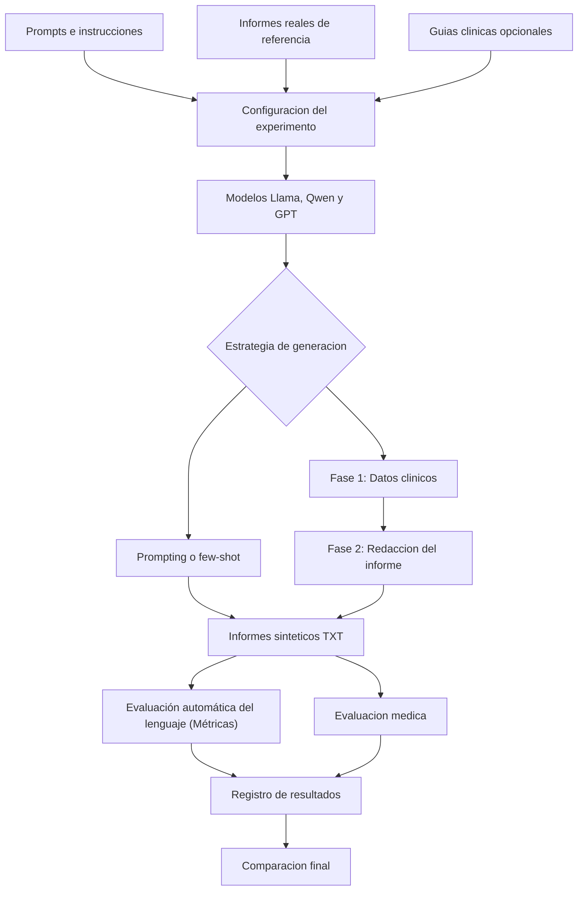

# Arquitectura de la solución

## 1. Visión general

El proyecto tiene como objetivo generar y evaluar informes clínicos sintéticos de pacientes adultos con cáncer de cabeza y cuello en el ámbito de la Oncología Radioterápica.

Para ello, se utilizan diferentes modelos de lenguaje y estrategias de generación. Los informes obtenidos se almacenan y evalúan mediante métricas automáticas, modelos de lenguaje evaluadores y revisión clínica, con el objetivo de comparar los resultados e identificar las estrategias más adecuadas.

## 2. Diagrama de arquitectura

## 3. Descripción de los componentes

### 3.1. Datos e instrucciones de entrada

Se utilizan prompts que definen las características y la estructura de los informes, junto con informes clínicos de referencia desidentificados para los experimentos few-shot. En determinadas configuraciones también se incorporan guías clínicas para orientar la generación.

### 3.2. Configuración y modelos de lenguaje

Cada experimento establece el modelo utilizado, la estrategia de generación, la versión del prompt y los parámetros correspondientes.

Se estudian distintos modelos de lenguaje, principalmente Llama, Qwen y GPT, para analizar las diferencias en la calidad de los informes producidos.

### 3.3. Generación de informes

Se contemplan tres estrategias principales:

- Prompting: generación a partir de instrucciones, sin ejemplos adicionales.
- Few-shot prompting: generación utilizando instrucciones e informes de referencia.
- Generación en dos fases: primero se construye la información clínica de un paciente ficticio y después se redacta el informe completo a partir de ella.

Los documentos resultantes contienen información sintética sobre antecedentes, pruebas diagnósticas, diagnóstico, tratamiento y evolución clínica.

### 3.4. Almacenamiento

Los informes generados se guardan en archivos individuales de texto plano (.txt), organizados por modelo y estrategia. Se conserva la información necesaria para identificar las condiciones de cada experimento.

### 3.5. Evaluación de informes

La evaluación combina distintos métodos:

- BLEU-4: mide la similitud textual entre los informes generados y los informes de referencia.
- BERTScore F1: mide la similitud semántica entre los textos.
- Evaluación médica: una especialista revisa informes seleccionados para valorar su coherencia clínica, detectar errores y analizar su realismo.

Las métricas automáticas no se interpretan como una garantía de corrección médica.

### 3.6. Comparación de resultados

Se reúnen las evaluaciones obtenidas y se organizan en tablas y archivos comparativos para estudiar las diferencias entre modelos, prompts y estrategias.

Se analizan las puntuaciones, los errores clínicos detectados y las valoraciones de la especialista para elaborar las conclusiones del proyecto.

## 4. Flujo de funcionamiento

1. Se selecciona el modelo, el prompt y la estrategia de generación.
2. Se incorporan los ejemplos clínicos o las guías cuando corresponda.
3. El modelo genera el informe directamente o mediante dos fases.
4. Los informes se almacenan en archivos de texto identificables.
5. Se evalúan mediante métricas automáticas y revisión médica cuando esté disponible.
6. Se registran las evaluaciones y los errores encontrados.
7. Se comparan los modelos y estrategias para analizar sus ventajas y limitaciones.

## 5. Limitaciones

Los informes son sintéticos y se utilizan exclusivamente para investigación y experimentación. No están destinados a su utilización clínica real.

Las métricas de similitud textual y semántica no garantizan que los documentos sean médicamente correctos, por lo que resulta necesaria una revisión clínica complementaria.

Disponibilidad limitada de informes reales. Únicamente disponemos de 6 informes clínicos reales, de los cuales 3 se utilizan como ejemplos de entrenamiento (few-shot) y 3 se reservan para la evaluación. Esta cantidad limitada puede afectar a la representatividad de los resultados y dificulta obtener conclusiones generales sobre el rendimiento de los modelos.
